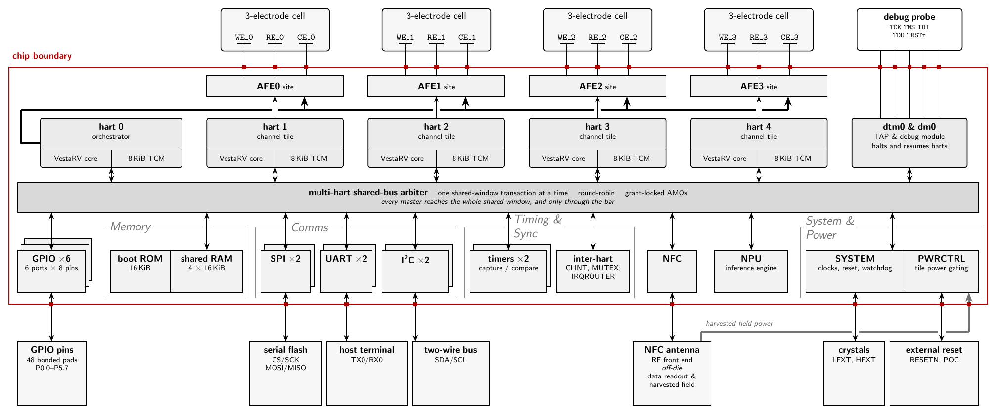

<table border="0" cellspacing="0" cellpadding="0">
  <tr>
    <td>
      
      
    </td>
    <td style="padding-left:12px;">
      <h1 style="margin:0;">VestaRV - A Custom RISC-V Core &amp; SoC</h1>
    </td>
  </tr>
</table>

[](https://github.com/maxxseminario/VestaRV/actions/workflows/ci.yml)
[](https://github.com/maxxseminario/VestaRV/actions/workflows/sim.yml)
[](https://github.com/maxxseminario/VestaRV/actions/workflows/physical.yml)

VestaRV is a 32-bit RISC-V processor core written in VHDL from the official
instruction-set specification, deriving from no existing implementation. The
repository around it is a chip generator: one configuration file fixes the hart
count, the ISA and the peripheral set, and one build emits that chip's RTL, C
headers, linker scripts, pad ring and Technical Reference Manual together. 337
Bazel tests hold every configuration to its sources, from register-description
versus RTL comparisons through a license-free GHDL regression of the core.

> **[Technical Reference Manual - Castalia, revised September 12, 2026](implementations/asic/castalia/docs/TRM.pdf)** (315 pages, build `a4fafc19`)  
> Register reference, system architecture, debug/JTAG chapter, analog front-end
> chapter and programming guide for the five-hart chip, generated from the chip
> configuration by [`platform/common`](platform/common/README.md).  
> Also tracked: the [Myshkin TRM v1.0.0](implementations/asic/myshkin-2025-11/docs/TRM.pdf), the first VestaRV tape-out.

> **Current version: v2.11.0**, the multi-core line. Silicon to date is
> **v1.0.0** (Myshkin, TSMC 65nm, November 2025); no `2.x` configuration has
> been fabricated. Full history in the [changelog](CHANGELOG.md).

Named after **Vesta**, Roman goddess of hearth and the eternal flame.



Figure 2 of the TRM, drawn flat: every master in a band across the top, the
multi-hart shared-bus arbiter as the single bus bar it behaves like, and the
peripherals of the default configuration in one rank below it, with the package
boundary in red. The four AFE sites are the analog channels the TRM's Analog
Front-End chapter measures.

---

## First run

```bash
git clone https://github.com/maxxseminario/VestaRV.git && cd VestaRV
sh tools/get_bazel.sh            # fetches bazelisk into tools/bin/bazel
tools/bin/bazel test //...       # the whole gate set; nothing to install first
tools/bin/bazel run //:generate  # emit the chip
```

`test //...` is 337 automatic targets (14 more are tagged `manual`): the
generated RTL against the tracked RTL, the register descriptions against both
the VHDL and the C headers, firmware and mask-ROM images against their goldens,
and the license-free GHDL ISA regression. Cold it is 10-20 minutes, nearly all
of it fetching ~1 GB of toolchains and building GHDL from source; measured here
with `time` on a **warm** cache it reports in about a second, and forcing every
test to execute again is about ten minutes. `//:generate` writes RTL to
`platform/common/out/hdl/`, C headers to `out/software/include/`, linker scripts
to `out/linker-scripts/`, the pad ring to `out/pnr/` and the TRM sources to
`platform/common/latex/TRM/`.

**The ASIC starting point is
[`config/asic_default.json`](platform/common/config/asic_default.json)**: one
hart, no orchestrator, the smallest configuration that goes through synthesis,
place-and-route and LVS.

```bash
make -C platform/common generate CONFIG=config/asic_default.json
tools/bin/bazel build //platform/common:chip_artifacts_asic_default
tools/bin/bazel test //opensource_sim/asic_default:asic_default_elaborate \
                     //opensource_sim/asic_default:asic_default_boot
```

**The FPGA starting point is
[`config/fpga_default.json`](platform/common/config/fpga_default.json)**: one
hart, no board in particular; the RTL is the deliverable and
[`hdl/fpga/`](hdl/fpga/README.md) holds the synthesizable stand-ins.

```bash
make -C platform/common generate CONFIG=config/fpga_default.json
tools/bin/bazel test //opensource_sim/fpga_default:fpga_default_elaborate
```

The FPGA clock cells (27 clock nets on an Artix-7's 32 buffers), the out-of-context
Vivado run and the constraints template are in
[`implementations/fpga/synth/`](implementations/fpga/synth/README.md).

---

Both recipes are written out with the gate that refuses each mistake in
[`docs/new_chip.md`](docs/new_chip.md): configure and prove a chip of your own,
then add a peripheral to it.

## ISA

**Always built**, with no knob that removes them:

- RV32I base integer instruction set.
- `cycle`, `instret` and their high halves. `time`/`timeh` are implemented in no build and trap.
- Stack-based recursive interrupt handling.

**Per-hart class** (`isa.minimalTiles`), generated into `derived.hartClasses` in [`platform/common/config/ChipConfig.resolved.json`](platform/common/config/ChipConfig.resolved.json), which is where these rows and the same table in the TRM come from. A minimal tile is rv32iac and nothing more: the `TILE_ENABLE_*` constants drop M, Zb, every Z extension, U-mode and PMP, while A, C and the trap CSRs are kept (debug is not per-class: the Debug Module halts tiles). Anything more than one class executes is built for the narrowest row (graded on the linked ELF by `//software/testtools:tile_isa_test`).

| Hart class | Harts | ISA string | Privilege |
| --- | --- | --- | --- |
| Orchestrator, soft core | 0 | `rv32imac_zba_zbb_zbs_zbc` | M-mode, trap CSRs, debug |
| Tile, hardened `hart_tile` macro | 1-4 | `rv32iac` | M-mode, trap CSRs, debug |

**Selectable per configuration.** Each knob generates its hardware away when off
and traps the encoding as an illegal instruction; a read-only `misa` advertises
I, M, A, B, C and U. These default on:

- **Base extensions:** `isa.mul` (M multiply) `isa.div` (M divide) `isa.atomics` (A, LR/SC and AMO) `isa.compressed` (C) `isa.bitmanip` (Zba/Zbb/Zbc/Zbs).
- **Core and tile shape:** `core.fetchAhead` (one flop, removes most of the C-extension straddling-fetch stall) `isa.minimalTiles` (the table above; it costs no extra hardening because the tiles are one macro instanced four times).
- **Privilege:** `priv.trapCsr` (M-mode trap CSRs and standard delivery; firmware opts in via `mtrapctl`) `debug.enable` (debug mode, the Debug Module and the JTAG DTM).

Eighteen ISA knobs and two privilege knobs default off. Compute: `isa.zfinx` (single-precision FP in the x-registers) `isa.zicond`. Crypto: `isa.zkn` (AES and SHA) `isa.zbkb` `isa.zbkc` `isa.zbkx`. Code size: `isa.zcmp` `isa.zcmt` `isa.zcb`. Memory and atomics: `isa.zicboz` `isa.zabha` `isa.zacas` `isa.zawrs`. Counters and hints: `isa.counters` `isa.counters64` `isa.zihpm` `isa.zihint` `isa.zimop`. Privilege: `priv.umode` (user mode) `priv.pmp` (Smpmp, 8 or 16 entries).

The 61-knob schema is `_CONFIG_SCHEMA` in
[`platform/common/python/generate.py`](platform/common/python/generate.py); an
unknown key raises rather than falling back to a default.

---

## Build and verify

Everything builds and tests through **Bazel**, hermetically: a fresh clone needs
no locally installed toolchain. Bazel provisions Python 3.11, a C/C++ toolchain
(zig), the exact RISC-V cross-compiler the mask ROM was pinned to, a from-source
GHDL and a hermetic TeX Live. `tools/bin/bazel` is bazelisk, which runs the
version pinned in `.bazelversion`; add `<repo>/tools/bin` to `PATH` for plain
`bazel`. Run every command from the repository root.

The first build fetches roughly 1 GB of toolchains and compiles GHDL from source
(10-20 minutes cold); after that everything is cached, including across
output-base wipes (disk cache in `.bazelrc`). Old-glibc hosts are handled
automatically: the xPack `ld` is wrapped at fetch time when `~/local-glibc`
exists, and GHDL links with `-B/usr/bin`; both are inert on modern hosts.

| What you want | Command |
|---|---|
| The whole gate set | `tools/bin/bazel test //...` |
| Generate a chip (RTL, headers, linker scripts, pad ring, TRM sources), sandboxed | `tools/bin/bazel build //platform/common:chip_artifacts_castalia` (also `_argus`, `_castalia_b`, `_asic_default`, `_fpga_default`) |
| Prove the generated RTL matches the tracked RTL | `tools/bin/bazel test //platform/...` |
| Regenerate everything derived from the register descriptions (writes the tree) | `tools/bin/bazel run //:regs` |
| Build the mask-ROM image | `tools/bin/bazel build //software/bootrom_mp:rom_rcf` |
| Build every firmware app; golden gates | `tools/bin/bazel build //software/...`, `tools/bin/bazel test //software/...` |
| Build every ISA test program, plain and flashed | `tools/bin/bazel build //verification/isa:all_images` |
| Full ISA simulation regression (GHDL, no licenses) | `tools/bin/bazel test //opensource_sim:isa_regression` |
| PMP and MCU-level GHDL benches | `tools/bin/bazel test //opensource_sim/pmp:pmp //opensource_sim/mcu:mcu_elaborate` |
| Core and peripheral unit benches | `tools/bin/bazel test //hdl/common/tb:all` |
| Synthesizability of every block | `tools/bin/bazel test //hdl/common/synth:synth //toolchains/ghdl:synth_coverage_test` |
| CPI against recorded counts | `tools/bin/bazel test //verification/cpi:cpi_default` |
| Python tooling and docs gates | `tools/bin/bazel test //tools/... //docs/...` |
| Bind the FPGA cut against the synthesizable stand-in cells | `tools/bin/bazel test //opensource_sim/fpga_default:fpga_default_elaborate` |
| Write the ordered VHDL file list a Vivado run reads | `tools/bin/bazel build //opensource_sim/fpga_default:fpga_default_vivado_files` |
| TRM PDF (host TeX, `manual`) | `tools/bin/bazel build //platform/common/latex/bazel:trm_pdf_local` |

Configurations live in [`platform/common/config`](platform/common/config) and are
selected with `CONFIG=`. `castalia.json` is the reference chip: hart 0 is an
always-on soft `orch_tile` orchestrator in the centre band and harts 1-4 are
instances of one hardened `hart_tile` macro. `argus.json` is the frozen 18-hart
teaching chip, `asic_default.json` the minimal ASIC starting point and
`fpga_default.json` the FPGA one. A bare build with no `CONFIG=` is the
reference chip, which is the configuration the tracked RTL identity gates grade.

A fully open-source path needs no proprietary EDA license:
`//opensource_sim:isa_regression` runs the riscv-tests-derived suite on a GHDL
built from source. The cocotb smoke test, `./opensource_sim/run_sim.sh --smoke-only`,
runs outside Bazel. See [`opensource_sim/README.md`](opensource_sim/README.md)
and [`sky130/README.md`](sky130/README.md), the companion flow that takes the
same RTL to a signed-off sky130 GDSII.

### Writers

`bazel build` and `bazel test` are sandboxed and never write into the source
tree. The `bazel run` targets that do are deliberate and enumerated: `//:regs`
and the three emitters it chains (`//platform/common/python:rdl_vhdl_pkgs`,
`:rdl_regs_headers`, `:generate`). `bazel run //:generate` is the
raw generator and writes wherever its `--out` points (default `platform/common/`);
use `chip_artifacts_<chip>` for a sandboxed build and `//:regs` to update tracked
products.

```bash
tools/bin/bazel run //:regs                    # .rdl -> VHDL packages -> C headers -> generator
```

### Outside Bazel

- **Cadence flows**: Xcelium regressions (`xcelium/*/xrun_parallel.sh`),
  Genus, Innovus, Pegasus, `make verify` and the PSL runs need licensed tools;
  run them after `source cdspaths.sh`. They are permanently out of `//...`; a
  future wrapper must be tagged `manual`, `local` and `no-sandbox`.
- **In-tree regeneration** of tracked products such as `hdl/common/MCU.vhd` or
  `hdl/common/regs/vhdl/` goes through the writers above (or
  `make -C platform/common chip` for the generator half); `bazel test
  //platform/...` proves the result. Fully hermetic LaTeX is blocked upstream
  (bazel_latex is lualatex-only and lacks packages the TRM uses).
- **Bench tools** (`rv4th_terminal.py`, the Forth dashboard, flash and chip
  programmers) talk to physical boards; their pip dependencies are unpinned.
- **Myshkin generator** (`platform/myshkin`) overwrites tracked files in place,
  so it cannot be sandboxed; run it directly.
- **Spike lockstep build** (`tools/cosim/build_vesta_ref.sh`) uses an
  out-of-repo pinned Spike.

### Conventions

- **Goldens**: firmware images are locked by tracked `testdata/*_golden.txt`
  files (`*.rcf` is gitignored). Changing firmware means regenerating the golden
  in the same commit.
- **Known red**: CI passes `--test_tag_filters=-known_red` so a failure that is
  understood but not yet adjudicated can be tagged rather than left to rot. The
  tag comes off in the commit that adjudicates it. `check_publish_test` (manual)
  is red whenever TRM-affecting commits have landed since the last publish; that
  is the point of the gate.
- **`private/`** is gitignored and listed in `.bazelignore`; its BUILD files name
  artifacts the public tree does not define. The Genus and Xcelium flows read it
  directly.
- **Untracked-file skew**: local `bazel test //...` sees untracked files; CI's
  clean checkout does not. Before pushing BUILD-graph changes run
  `git stash -u && tools/bin/bazel build //... ; git stash pop`, or use a clean
  worktree.
- **CRLF is load-bearing** in much of the VHDL; never let a tool rewrite line
  endings. Hygiene gates (CRLF manifest, VHDL ASCII style, `.bazelignore`,
  tracked outputs) are in [`tools/ci/`](tools/ci/README.md).
- A new `BUILD.bazel` inside `hdl/` creates a package that hides its files from
  `//hdl:vhdl_sources`'s glob; re-export them through a filegroup as
  `//hdl/common/tb:tb_vhdl_sources` does.
- The EDA output trees (`signoff_mp/`, `xcelium/`, `innovus/`, `genus/`,
  hundreds of GB) are listed in `.bazelignore`; never remove entries.

### CI

| Workflow job | Runs |
|---|---|
| `ci.yml` **Bazel hermetic gates** | Lockfile check, analysis of `//...`, then every test outside the GHDL trees; asserts `git status --porcelain` is empty afterwards |
| `sim.yml` **GHDL ISA regression (bazel)** | The GHDL targets, each named explicitly |
| `ci.yml` **Chip generator gates**, **Docs link + generator syntax gates**, **Bootrom + ISA image builds**, **Repo hygiene gates** | Scripts run directly (the hygiene checks need git history) |
| `physical.yml` **Verilog bridge (GHDL synth)**, **Core smoke sim (cocotb on GHDL)**, **Full GDSII hardening + signoff gate (LibreLane)** | Bridge and smoke when `hdl/` or `sky130/` changes; hardening weekly, on dispatch, on the `run-physical` label and per release ([`sky130/README.md`](sky130/README.md)) |
| `release.yml` | Tag `vX.Y.Z`: changelog gate, `physical.yml` with hardening, GitHub release |

```bash
tools/bin/bazel mod deps --lockfile_mode=error
tools/bin/bazel build --nobuild -- //... -//opensource_sim/... -//hdl/common/tb/... -//toolchains/...
tools/bin/bazel test --build_tests_only --test_tag_filters=-known_red \
  -- //... -//opensource_sim/... -//hdl/common/tb/... -//toolchains/... \
     -//hdl/common/synth/... -//verification/cpi/... -//implementations/fpga/bringup/...
```

- The `--` before the negative patterns is required; Bazel rejects a bare
  leading `-//...` as a malformed option.
- `//hdl/common/synth`, `//verification/cpi` and `//implementations/fpga/bringup`
  run GHDL, so they are tested in `sim.yml` but still analyzed in `ci.yml`, which
  catches a broken BUILD file in seconds.
- `ci.yml` runs on every push to `main`, PR and merge-queue candidate. `sim.yml`
  skips changes confined to `docs/` and `*.md`; `physical.yml`'s fast jobs run
  only when `hdl/` or `sky130/` changes. Superseded PR runs are cancelled.
- `sim.yml` never uses `//opensource_sim/...` by wildcard. A new GHDL target runs
  in a local `bazel test //...` but in **neither** workflow until it is named in
  `sim.yml`.
- Required-check names are matched verbatim by the merge-queue ruleset; rename a
  job only together with the ruleset. See
  [`.github/MERGE_QUEUE.md`](.github/MERGE_QUEUE.md).

---

## Peripherals

One row per block in the default and `castalia.json` configurations. `Regs` is
the block's register count and `Dflt` / `Chip` its instance count in each, all
read out of the generated register map (`out/web/MemoryMap.json`); `RF` marks the
blocks that instantiate the shared register-file module (`_REGFILE` in
[`platform/common/python/rdl_vhdl.py`](platform/common/python/rdl_vhdl.py));
`Bench` names a [`hdl/common/tb`](hdl/common/tb/BUILD.bazel) target, except NPU's,
which is `//verification/npu`; MUTEX has none.

| Block | Function | Regs | Dflt | Chip | RF | Bench |
|---|---|---|---|---|---|---|
| GPIO | General-purpose eight-pin port whose every pin carries an alternate-function mux onto a peripheral signal | 13 | 6 | 6 | Y | `GPIO_tb` |
| SPI | Serial peripheral interface that operates as bus master or as addressed slave | 5 | 2 | 2 | Y | `SPI_tb` |
| UART | Full-duplex asynchronous serial port with hardware parity generation and checking | 5 | 2 | 2 | Y | `UART_tb` |
| TIMER | 32-bit timer and counter with input capture, output compare and edge-aligned PWM | 8 | 2 | 2 | Y | `TIMER_tb` |
| SYSTEM | Clock sourcing and DCO trim, reset control, watchdog, power state and a CRC16 engine | 11 | 1 | 1 | Y | `SYSTEM_tb` |
| NPU | Fixed-point MLP accelerator that evaluates one fully-connected layer per pass | 7 | 1 | 1 | Y | `npu` |
| PWRCTRL | MTCMOS cold-gating controller that sequences the switchable tile power domains | 5 | 1 | 1 | - | `pwr_ctrl_tb` |
| QSPI | Quad-SPI flash controller with configurable lane widths and execute-in-place fetch | 6 | - | 1 | Y | `QSPI_tb` |
| I2C | I2C port that operates as bus master or as addressed slave | 9 | 2 | 2 | Y | `I2C_tb` |
| CLINT | Core-local interruptor holding per-hart `msip`, one shared `mtime` and per-hart `mtimecmp` | 17 | 1 | 1 | - | `irq_sys_tb` |
| MUTEX | Sixteen word-mapped advisory locks for single-instruction cross-hart exclusion | 16 | 1 | 1 | - | - |
| I3C | MIPI I3C basic single-controller with dynamic address assignment and in-band interrupts, interoperable with legacy I2C targets | 9 | - | 1 | Y | `I3C_tb` |
| NFC | ISO/IEC 14443A tag and card-emulation engine whose RF front end sits off the die | 10 | 1 | 1 | Y | `NFC_tb` |
| RTC | 32.768 kHz always-on wall clock with an alarm and a periodic tick | 7 | - | 1 | Y | `RTC_tb` |
| PWM | Glitch-free two-channel edge-aligned generator whose waveform registers are double-buffered | 9 | - | 1 | Y | `PWM_tb` |
| OneWire | Dallas/Maxim 1-Wire master that runs the bus primitives in hardware | 7 | - | 1 | Y | `OneWire_tb` |
| DMA | Four-channel single-shot controller that masters the shared arbiter, paced by software or by an event | 20 | - | 1 | Y | `DMA_tb` |
| TRNG | Ring-oscillator entropy source with a harvest engine and a repetition-count health test | 4 | - | 1 | Y | `TRNG_tb` |
| I2CTarget | Hardware-autonomous I2C target with address match and clock stretching | 5 | - | 1 | Y | `I2CTarget_tb` |
| EVFAB | PPI-style event and trigger crossbar, eight channels, with no processor in the loop | 29 | - | 1 | Y | `EVFAB_tb` |
| PINMUX | Pin multiplexer giving each of the nineteen spare digital pads a register-selected function out of that pad's own menu | 5 | - | 1 | Y | `PINMUX_tb` |
| IRQROUTER | Per-hart interrupt routing and enable rows ahead of a claim and complete stage | 29 | 1 | 1 | - | `irq_router_tb` |

227 registers over 21 blocks in the default configuration, 328 over 31 in
`castalia.json`. Eighteen blocks instantiate `periph_regs` and keep only their
datapath; IRQROUTER cannot, because its `CLAIM` word sits past the module's
64-word decode window. CLINT, MUTEX, PWRCTRL and PINMUX have a register SET that
is a function of a generic -- the hart, mutex or pad count -- so their eight
tables are emitted as FUNCTIONS of it rather than as constant aggregates. See
[`hdl/common/regs/REGFILE.md`](hdl/common/regs/REGFILE.md).

---

## Register flow

`hdl/common/regs/rdl/` is the authority: one hand-written SystemRDL description
per block, 22 of them, plus the user-defined properties and the chip addrmap.

A width, an access code, a reset value or a field description written there
reaches the 22 VHDL packages in `hdl/common/regs/vhdl/`, the 21 C headers in
`software/include/regs/`, `MemoryMap.h`, `MemoryMap.vhd`, the generator's
peripheral templates and the TRM register chapters. Nothing generated is ever
hand-edited.

The gates: `//platform/common:rdl_vhdl_pkg_test` fails on a one-byte difference
between a tracked package and a fresh emission, `:rdl_pkg_vs_legacy_test` grades
every value against the constants frozen before the migration, the 21
`:rdl_vs_vhdl_<block>_test` targets re-derive each decode out of the VHDL and
compare it against the description, and `:regs_headers_identity_test` and
`:regs_headers_compile_test` do the same for the headers.

Regenerate the whole chain with `tools/bin/bazel run //:regs`, then review with
`git status`. Details in
[`hdl/common/regs/README.md`](hdl/common/regs/README.md) and
[`tools/rdl/README.md`](tools/rdl/README.md).

---

## Repository layout

| Path | Contents |
|---|---|
| [`hdl/`](hdl/README.md) | VHDL-2008 RTL: live shared tree in `hdl/common/`, frozen chip snapshots, FPGA stand-in cells |
| [`platform/`](platform/common/README.md) | Chip generators: `platform/common` (Castalia, Argus, defaults), frozen [`platform/myshkin`](platform/myshkin/README.md) |
| [`implementations/`](implementations/README.md) | Per-chip documentation, TRMs and FPGA flows |
| [`software/`](software/README.md) | Mask boot ROM, debug trampoline, firmware apps, shared headers |
| [`verification/`](verification/README.md) | ISA test images, NPU golden model, CPI and multi-hart performance harnesses, coverage, conformance |
| [`opensource_sim/`](opensource_sim/README.md) | License-free GHDL simulation targets |
| [`sky130/`](sky130/README.md) | Open-source RTL-to-GDSII flow on SkyWater sky130 |
| `tools/` | Build scripts ([`build`](tools/build/README.md)), CI checks ([`ci`](tools/ci/README.md)), Spike lockstep ([`cosim`](tools/cosim/README.md)), SystemRDL ([`rdl`](tools/rdl/README.md)), bench debug ([`debug`](tools/debug/README.md)), random-program generator (`randgen`), Python utilities |
| `toolchains/` | Bazel toolchain rules: from-source GHDL, pinned RISC-V GCC |
| `docs/` | New-chip guide ([`docs/new_chip.md`](docs/new_chip.md)) |
| `assets/` | Logos and README figures |
| `cdspaths.example.sh` | Template for `cdspaths.sh` (gitignored), the environment for the licensed Cadence flows; scripts source it via `tools/source_cdspaths.sh` |

`genus/`, `innovus/`, `xcelium/`, `signoff_mp/`, `cpf/`, `std_cells/` and
`private/` are gitignored working trees for the licensed flows.

## Author and support

_Maxx Seminario_  
PhD Student, Integrated Circuit Design  
Analog, Mixed-Signal, and System-on-Chip Design  
University of Nebraska-Lincoln  
Email: mseminario2@huskers.unl.edu

For access, support or questions about VestaRV or its MCU subsystem, contact the
author by email.

This repository is published for reference and does not accept external
contributions at this time.

## License

VestaRV is released under the **MIT License**. See [`LICENSE`](LICENSE) for full details.
